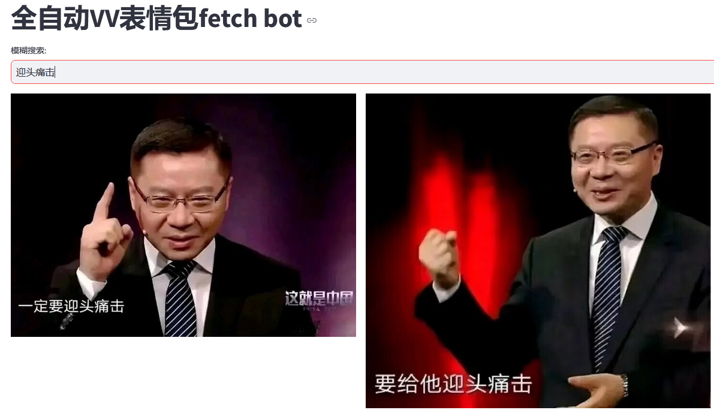

# 全自动张维为教授表情包fetch bot
Automatic VV meme retrieval


## Getting Started

```bash
python3.12 -m venv .venv && source .venv/bin/activate   # 建议 3.12；3.13 尚无旧版 OCR 依赖的 wheel
pip install -r requirements.txt
streamlit run web.py        # → http://localhost:8501
```

`txts/`、`text_list.txt`、`text_to_filepath.json` 已在仓库内，开箱即可检索，无需 OCR。

### 新增/重建数据（可选）

```bash
pip install -r requirements-ocr.txt
pip install --no-deps "cnocr==2.3.1" "cnstd==1.2.5.2"   # 跳过它们声明的 wandb / onnx 等未使用依赖
python data_update.py      # 需先 source .venv/bin/activate，模型下载要用 venv 里的 huggingface-cli
```

## sources: 
感谢网友分享的图集:
- [求求张维为老师的表情包? - 知乎](https://www.zhihu.com/question/602544213)
